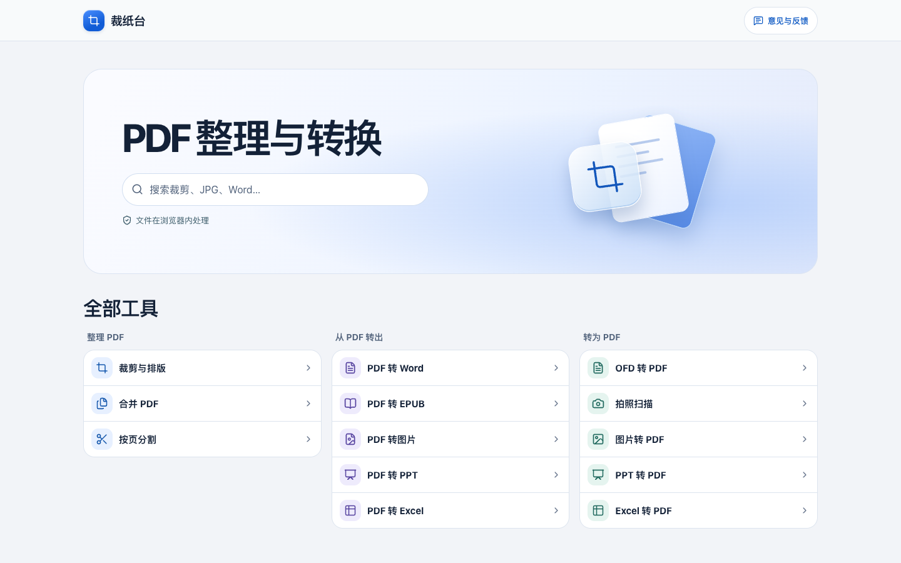
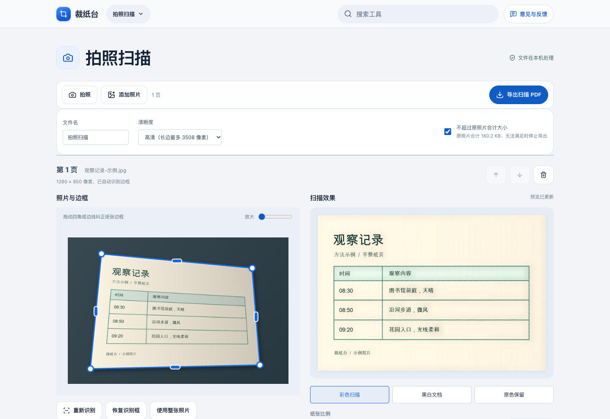

# Caizhitai (裁纸台)

[简体中文](README.md) · **English** · [日本語](README.ja.md) · [한국어](README.ko.md)

Caizhitai is an open-source browser toolkit for documents. Trim scan borders, organize PDF pages, straighten photos into scanned PDFs, or convert between PDF, images, and common office formats. Files are processed in your browser, and the live tools work without an account.

**[Try Caizhitai online](https://tuditudi.github.io/caizhitai-pdf/)** · [Send feedback](https://wj.qq.com/s2/28624021/oft7/)

## Quick start

1. Search by tool name or format, such as JPG or EPUB, or browse the categories on the home page. The tool pages have a search box and a tool switcher.
2. Choose a file from your device or drag it into the tool. To try cropping with a sample, open [Crop and resize](https://tuditudi.github.io/caizhitai-pdf/#/tools/crop) and click 「先用示例试试看」 (Try a sample).
3. Adjust the settings, review the preview, and download the result before refreshing or closing the tab.

The interface is in Simplified Chinese. Chinese labels in this README match the controls on screen.

## Crop and resize

Select a page and drag the corners or edges of the blue box, or enter margins in millimeters. A **3× magnifier** shows the paper edge and the blue crop guide while you drag and disappears when you release. Switch to 「缩放排版」 (Scale and layout) to adjust paper size, spacing, or content size. The magnifier also appears when you drag content across the page. You can rotate, reorder, and delete pages or apply the current settings to all pages. On a phone, tap 「查看裁剪设置」 (View crop settings) to reach the margin controls.

[View the mobile crop editor](docs/images/crop-mobile.png)

The cropped PDF can be **at most as large as the original in bytes**. The tool tries to reuse the original images and text and can apply compression if the result exceeds the limit. Compression can reduce image quality or remove the searchable text layer. The download stops if the file is still too large. Cropping can leave hidden data outside the visible area, so use a dedicated redaction tool for sensitive content.

## Photo scanner

Take a photo or import JPG, PNG, WebP, or HEIC/HEIF. Caizhitai tries to find the four paper corners, corrects perspective, and generates a preview automatically. Drag corners or edges, choose a color mode, or adjust enhancement, paper ratio, and rotation. The preview updates as you work. Reorder multiple photos and export them as one scanned PDF.

The scanner can also detect rounded card edges. Color or original colors make it easier to inspect fine print and patterns on cards. Batch imports show progress, and the tool asks you to review edges when detection is uncertain. The output is an image-based PDF. By default, the combined size of the input photos is the export limit. You can turn that limit off in the scanner.

## Convert documents

- **PDF to Word.** After recognition, scroll through the pages and click text to edit it in place. Export a DOCX with editable Word text boxes over a page background that retains table lines, photos, and stamps. If a PDF contains only a font subset, supply the matching complete font with editable embedding rights (TTF, OTF, or TTC). Scanned pages use OCR and require you to choose a font. If glyphs are missing or text overflows its box, the editor prompts you to supply the font or adjust the box. [View the Word editor](docs/images/pdf-to-word.png)
- **PDF to EPUB.** Auto mode reflows pages with usable text. For scans and comics, choose page images to retain the layout. The first selected page is the default cover. The ebook language labels the EPUB and includes options such as Simplified Chinese, Traditional Chinese, English, Japanese, and Korean. OCR has a separate setting for Simplified Chinese plus English or English only. [View the EPUB converter](docs/images/pdf-to-epub.png)
- **OFD to PDF.** Preview the first page and export all or selected pages at their original sizes. The converter uses vector text outlines and lines where possible, lossless high-resolution images for complex pages, and font substitutes when embedded fonts are unavailable. Verify digital signatures in the original OFD. [View the OFD converter](docs/images/ofd-to-pdf.png)

## All 13 tools

| Tool | What you can do |
| --- | --- |
| [Crop and resize](https://tuditudi.github.io/caizhitai-pdf/#/tools/crop) | Trim borders, resize paper or content, and reorder pages. |
| [Merge PDFs](https://tuditudi.github.io/caizhitai-pdf/#/tools/merge) | Arrange multiple PDFs and combine them into one. |
| [Split PDF](https://tuditudi.github.io/caizhitai-pdf/#/tools/split) | Split by page, group size, or custom ranges. <code>1-3,5;6-8</code> creates two PDFs. Multiple results are delivered as a ZIP. |
| [PDF to Word](https://tuditudi.github.io/caizhitai-pdf/#/tools/word) | Edit text in place and export a DOCX that preserves the page layout. |
| [PDF to EPUB](https://tuditudi.github.io/caizhitai-pdf/#/tools/epub) | Make an EPUB 3 with a table of contents and optional cover, using reflowable text or page images. |
| [PDF to images](https://tuditudi.github.io/caizhitai-pdf/#/tools/pdf-to-images) | Choose pages and resolution and export PNG or JPG. Download multiple images as a ZIP. |
| [PDF to PowerPoint](https://tuditudi.github.io/caizhitai-pdf/#/tools/pdf-to-ppt) | Make one image slide per selected PDF page and export PPTX. |
| [PDF to Excel](https://tuditudi.github.io/caizhitai-pdf/#/tools/pdf-to-excel) | Extract or recognize tables, review the cells, and export XLSX. You can also insert pages as images. |
| [OFD to PDF](https://tuditudi.github.io/caizhitai-pdf/#/tools/ofd-to-pdf) | Preview the first page and export selected pages at their original sizes. |
| [Photo scanner](https://tuditudi.github.io/caizhitai-pdf/#/tools/photo-scan) | Correct perspective, preview enhancements, and export a scanned PDF. |
| [Images to PDF](https://tuditudi.github.io/caizhitai-pdf/#/tools/images-to-pdf) | Arrange PNG, JPG/JPEG, WebP, BMP, or GIF files and combine them. GIFs use the first frame. |
| [PowerPoint to PDF](https://tuditudi.github.io/caizhitai-pdf/#/tools/ppt-to-pdf) | Preview a PPT or PPTX and export selected slides as static PDF pages. |
| [Excel to PDF](https://tuditudi.github.io/caizhitai-pdf/#/tools/excel-to-pdf) | Select sheets and orientation from an XLS, XLSX, or XLSM workbook and paginate by rows. |

## Files and feedback

- Import, preview, and export run in your browser. The website supplies shared assets such as OCR models and fonts.
- The per-file limits are 200 MB for PDF and 80 MB for OFD. Device memory also affects how well large or complex documents can be processed.
- Review OCR results, complex tables, and page layouts before downloading. Excel to PDF uses formula results saved in the workbook.
- The 「意见与反馈」 (Feedback) button on the home and tool pages opens a Tencent survey. Include the tool name, steps, and any error message when reporting a problem.

## Run locally

You need Node.js 22.13 or later, npm, and Python 3. Run these commands from the project directory.

~~~bash
npm ci
npm run build:web
python3 -m http.server 5176 --bind 127.0.0.1 --directory offline-dist
~~~

[Open Caizhitai in your browser](http://127.0.0.1:5176/)

## License

The project code is available under the [MIT License](LICENSE). Bundled assets follow their upstream licenses. [PDF](public/pdf-assets/LICENSE) · [OCR](public/ocr/NOTICE.md) · [Scanner](public/scanner/NOTICE.md) · [Office](public/office-assets/licenses.html) · [OFD](public/ofd-assets/)
