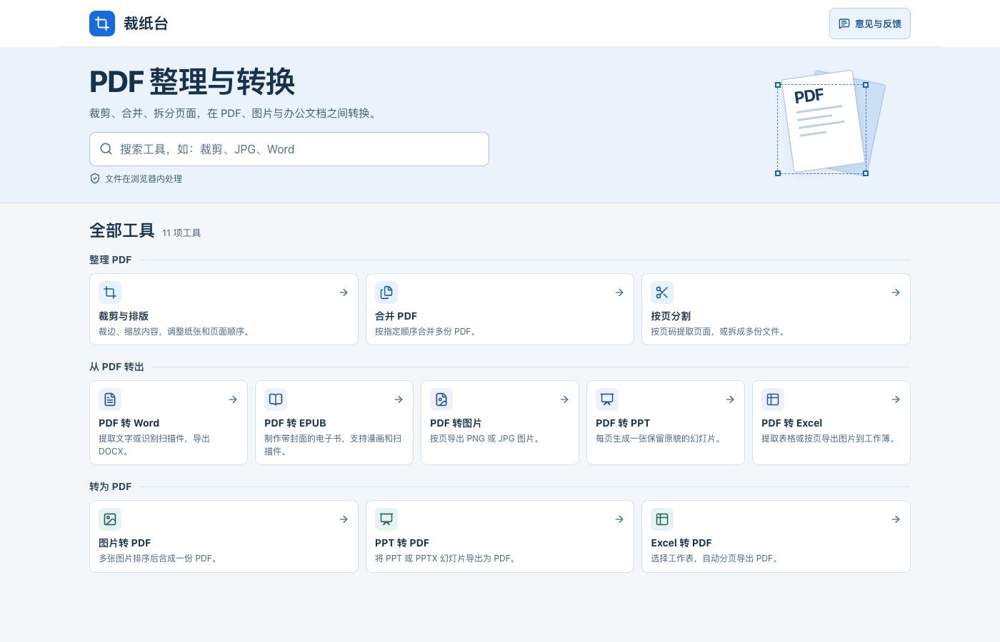
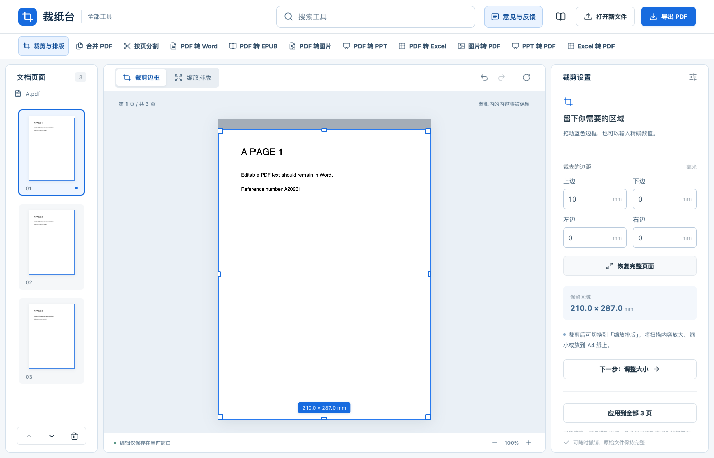

# Caizhitai (裁纸台)

[简体中文](README.md) · **English** · [日本語](README.ja.md) · [한국어](README.ko.md)

**[Try Caizhitai online](https://tuditudi.github.io/caizhitai-pdf/)** · [Send feedback](https://wj.qq.com/s2/28624021/oft7/)

Caizhitai is a browser-based PDF toolkit. Crop dark borders from scans, fit pages to A4 paper, merge or split documents, and convert between PDF, images, and common office formats. Your browser processes the files and conversion results locally.



## Quick start

1. Search for a tool by name or format, such as JPG, Word, or EPUB. You can also browse the categories or switch tools using the search box at the top of any tool page.
2. Select a file from your device. To try cropping with a sample, open 「裁剪与排版」 (Crop and resize) and click 「先用示例试试看」 (Try a sample).
3. Adjust the settings, check the preview, and download the result. Save your work before refreshing or closing the tab.

The interface is currently in Simplified Chinese. The Chinese labels above match the buttons on screen.

## 11 tools

| Tool | What it does |
| --- | --- |
| Crop and resize PDF | Drag the blue box or enter margins in millimeters. Adjust paper size, spacing, and scale, or rotate, reorder, and delete pages. |
| Merge PDFs | Add several PDFs, arrange their order, and save them as one file. |
| Split PDF | Split into single pages, fixed-size groups, or custom ranges. `1-3,5;6-8` creates two PDFs, packaged as a ZIP. |
| PDF to Word | Extract text or run OCR on Simplified Chinese and English scans. Review the text before exporting a DOCX, or preserve the original pages as images. |
| PDF to EPUB | Reflow text or preserve scanned pages and comics as images. By default, the first selected page becomes the cover. The ebook language labels the EPUB, and scan recognition has its own language setting. |
| PDF to images | Choose pages and resolution, then export PNG or JPG files. Multiple images can be downloaded as a ZIP. |
| PDF to PowerPoint | Turn each PDF page into a slide image and export a PPTX. |
| PDF to Excel | Extract tables or recognize scanned pages. Review the results and export XLSX, or insert each page as an image. |
| Images to PDF | Arrange PNG, JPG/JPEG, WebP, BMP, or GIF images and combine them into a PDF. GIFs use their first frame. |
| PowerPoint to PDF | Open PPT or PPTX files, preview the slides, and select which ones to export. |
| Excel to PDF | Open XLS, XLSX, or XLSM files. Select sheets and paper orientation, then export them as PDF pages. |

## Crop and resize

On desktop, choose a page from the thumbnails on the left. Drag the blue box around the area you want to keep, or enter the margins on the right. On a phone, tap 「查看裁剪设置」 (View crop settings) to jump to the margin controls. Switch to 「缩放排版」 (Scale and layout) to adjust the paper size or spacing.



[View the mobile crop editor](docs/images/crop-mobile.png)

A cropped export can be **at most as large as the original PDF in bytes**. Caizhitai tries to reuse the original images and text, then can attempt compression if the result exceeds the limit. It stops the download if the file is still too large. Compression may reduce image quality or remove the searchable text layer. Cropping can leave hidden content outside the visible area, so use a dedicated redaction tool for sensitive information.

## Run locally

You need Node.js 22.13 or later, npm, and Python 3. Run these commands from the project directory.

```bash
npm ci
npm run build:web
python3 -m http.server 5176 --bind 127.0.0.1 --directory offline-dist
```

Then open [Caizhitai on your device](http://127.0.0.1:5176/).

## Files and feedback

- PDF, image, and document conversion runs in the browser. The website serves shared resources such as OCR models and fonts.
- Each PDF can be up to 200 MB. The practical limit also depends on device memory and page complexity.
- You can review OCR results for Word and Excel in the preview. Complex layouts may be simplified. Excel to PDF uses the formula results saved in the workbook.
- Click 「意见与反馈」 (Feedback) on the home page or any tool page to open the Tencent survey. For bug reports, include the tool name, the steps to reproduce the issue, and any error message.

## License

Caizhitai's project code is available under the [MIT license](LICENSE). Bundled third-party resources, including PDF.js, Tesseract.js, OCR models, and fonts, retain their original licenses. See the notices for [PDF resources](public/pdf-assets/), [OCR resources](public/ocr/NOTICE.md), and [Office resources](public/office-assets/licenses.html).
