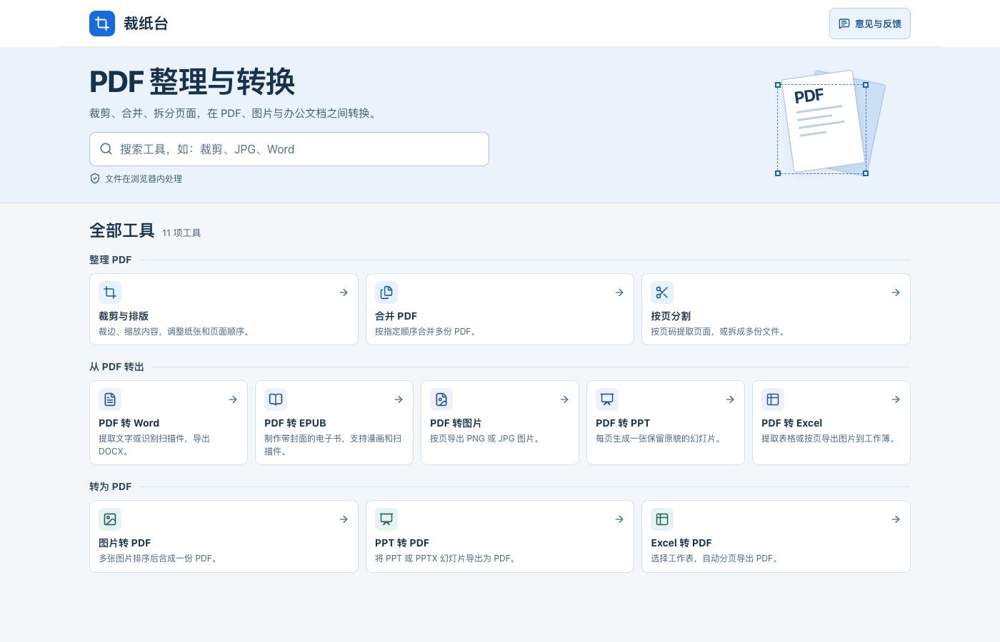
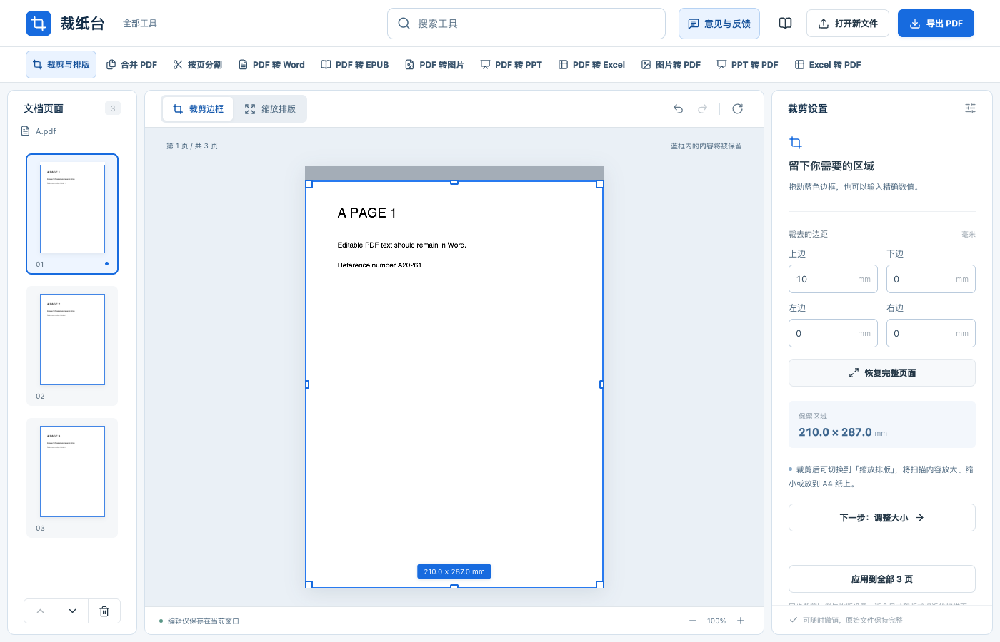

# 裁纸台（Caizhitai）

[简体中文](README.md) · [English](README.en.md) · **日本語** · [한국어](README.ko.md)

**[裁纸台をブラウザーで試す](https://tuditudi.github.io/caizhitai-pdf/)** · [ご意見・不具合の報告](https://wj.qq.com/s2/28624021/oft7/)

裁纸台はブラウザーで使える PDF ツールです。スキャンした文書の黒い縁を切り取って A4 に収めたり、PDF を結合・分割したりできます。PDF、画像、各種 Office ファイルの相互変換にも対応しています。読み込んだファイルと変換結果は、使用中のブラウザー内で処理されます。



## 使い方

1. トップページでツール名や「JPG」「Word」「EPUB」などの形式を検索するか、カテゴリからツールを選びます。各ツールの上部にある検索欄からも切り替えられます。
2. 端末のファイルを選びます。トリミングを試すには、「裁剪与排版」（トリミングとレイアウト）を開き、「先用示例试试看」（サンプルで試す）を選びます。
3. 設定を調整してプレビューを確認し、結果をダウンロードします。ページの再読み込みやタブを閉じる前に保存してください。

画面は現在、簡体字中国語で表示されます。かぎ括弧内の中国語は画面に表示される項目名です。

## 11 種類のツール

| ツール | できること |
| --- | --- |
| PDF のトリミングとレイアウト | 青い枠をドラッグするか、余白をミリ単位で指定します。用紙サイズ、余白、拡大率を調整でき、ページの回転・並べ替え・削除にも対応しています。 |
| PDF の結合 | 複数の PDF を追加し、順番を指定して 1 つのファイルにまとめます。 |
| PDF の分割 | 1 ページずつ、一定のページ数ごと、または指定範囲で分割します。`1-3,5;6-8` と入力すると 2 つの PDF が作成され、ZIP にまとめてダウンロードできます。 |
| PDF から Word へ | テキストを抽出するか、簡体字中国語・英語のスキャン画像を OCR で読み取ります。確認・修正して DOCX に書き出すほか、ページを画像として保持できます。 |
| PDF から EPUB へ | 文字はリフロー表示に、漫画やスキャンページは画像にできます。既定では選択した先頭ページが表紙になります。電子書籍の言語は EPUB の言語情報に使われ、OCR の認識言語は別に設定します。 |
| PDF から画像へ | ページと解像度を指定し、PNG または JPG に書き出します。複数の画像は ZIP でダウンロードできます。 |
| PDF から PowerPoint へ | PDF の各ページを 1 枚のスライド画像に変換し、PPTX に書き出します。 |
| PDF から Excel へ | 表を抽出するか、スキャンしたページを認識し、結果を確認・修正して XLSX に書き出します。ページごとに画像として挿入することもできます。 |
| 画像から PDF へ | PNG、JPG/JPEG、WebP、BMP、GIF を並べ替えて 1 つの PDF にまとめます。GIF は先頭フレームを使います。 |
| PowerPoint から PDF へ | PPT・PPTX に対応しています。スライドをプレビューして、書き出すページを選べます。 |
| Excel から PDF へ | XLS、XLSX、XLSM に対応しています。シートと用紙の向きを選び、ページごとに書き出します。 |

## トリミングとレイアウト

パソコンでは左側のサムネイルからページを選びます。残したい部分を青い枠で囲むか、右側で余白を入力します。スマートフォンでは「查看裁剪设置」（トリミング設定を表示）をタップすると、余白設定に移動できます。用紙や余白を調整するときは「缩放排版」（拡大縮小とレイアウト）に切り替えます。



[スマートフォンのトリミング画面を見る](docs/images/crop-mobile.png)

トリミング後のファイルサイズの上限は**元の PDF の実際のバイト数**です。元の画像や文字を優先して再利用し、上限を超える場合は圧縮を試せます。それでも上限を超える場合は、ダウンロードを中止します。圧縮によって画質が下がったり、検索可能なテキスト層が失われたりすることがあります。トリミングの範囲外にデータが残る場合があるため、機密情報を削除するには専用の墨消しツールを使ってください。

## ローカルで実行する

Node.js 22.13 以降、npm、Python 3 が必要です。プロジェクトのディレクトリで次のコマンドを実行します。

```bash
npm ci
npm run build:web
python3 -m http.server 5176 --bind 127.0.0.1 --directory offline-dist
```

実行後に [ローカル版の裁纸台](http://127.0.0.1:5176/) を開きます。

## ファイルとフィードバック

- PDF、画像、文書の変換はブラウザー内で行います。OCR モデルやフォントなどの共通リソースはウェブサイトから読み込みます。
- PDF 1 ファイルの上限は 200 MB です。実際に扱える容量は端末のメモリやページの複雑さによっても変わります。
- Word と Excel の認識結果はプレビューで確認・修正できます。複雑なレイアウトは簡略化される場合があります。Excel から PDF への変換では、ブックに保存された数式の計算結果を使います。
- トップページまたは各ツールの「意见与反馈」（フィードバック）から Tencent のアンケートを開けます。不具合の報告には、ツール名、再現手順、表示されたエラーメッセージを記載してください。

## ライセンス

裁纸台のプロジェクトコードは [MIT ライセンス](LICENSE) で公開されています。同梱する PDF.js、Tesseract.js、OCR モデル、フォントなどには、それぞれの上流ライセンスが適用されます。[PDF リソース](public/pdf-assets/)、[OCR リソース](public/ocr/NOTICE.md)、[Office リソース](public/office-assets/licenses.html) のライセンス情報をご覧ください。
