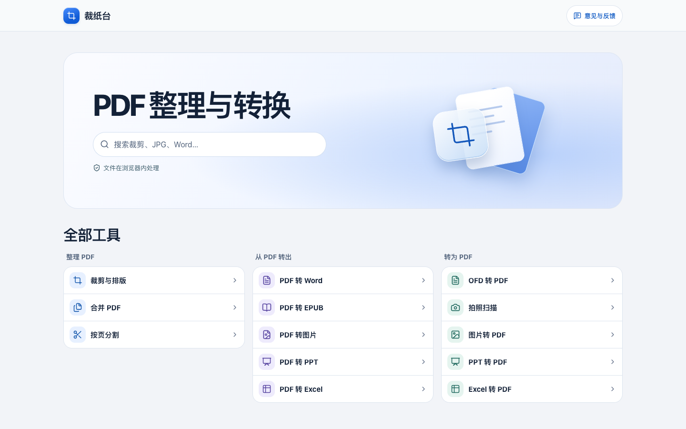
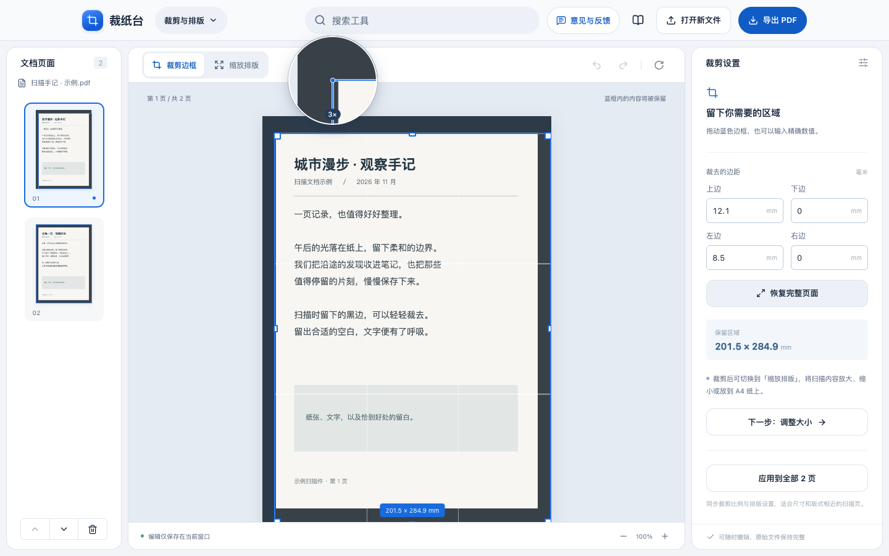
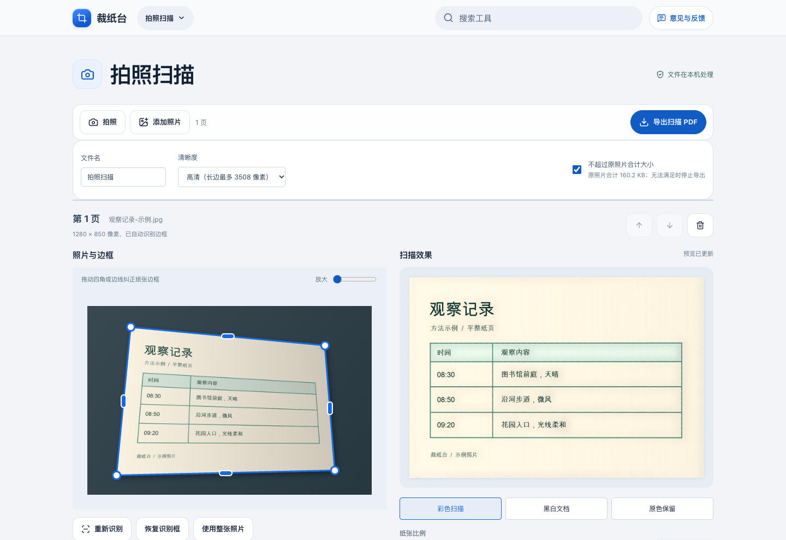

# Caizhitai（裁纸台）

[简体中文](README.md) · [English](README.en.md) · **日本語** · [한국어](README.ko.md)

裁纸台は、ブラウザーで使えるオープンソースの文書ツールです。スキャンの黒い縁を切り取る、PDF のページを整理する、紙を撮影した写真を補正して PDF にする、PDF・画像・Office 文書を変換するといった作業ができます。ファイルは端末のブラウザーで処理され、オンライン版はアカウント登録なしで使えます。

**[オンラインで試す](https://tuditudi.github.io/caizhitai-pdf/)** · [フィードバック](https://wj.qq.com/s2/28624021/oft7/)

## クイックスタート

1. トップページで JPG や EPUB などの形式・ツール名を検索するか、カテゴリから選びます。各ツールの画面上部からも検索して切り替えられます。
2. 端末のファイルを選ぶか、画面にドラッグします。トリミングを試すには、[トリミングとレイアウト](https://tuditudi.github.io/caizhitai-pdf/#/tools/crop)を開き、「先用示例试试看」（サンプルで試す）を押します。
3. 設定とプレビューを確認し、結果をダウンロードします。画面を更新したりタブを閉じたりする前に保存してください。

画面は簡体字中国語です。このガイドの中国語表記は画面上のボタン名に対応します。

## トリミングとレイアウト

ページを選び、青い枠の角や辺をドラッグするか、切り取る余白をミリ単位で入力します。ドラッグ中は **3 倍の拡大鏡**に用紙の端と青いガイド線が表示され、指やマウスボタンを離すと消えます。「缩放排版」（拡大縮小とレイアウト）で用紙サイズ・余白・内容の大きさを調整でき、内容をドラッグしたときにも拡大鏡が表示されます。ページの回転、並べ替え、削除、設定の一括適用にも対応しています。スマートフォンでは「查看裁剪设置」（トリミング設定を表示）から余白設定に移動できます。

[スマートフォンのトリミング画面を見る](docs/images/crop-mobile.png)

書き出しの上限は**元の PDF の実際のバイト数**です。元の画像と文字の再利用を優先し、上限を超える場合は圧縮を試せます。圧縮で画質が低下したり、検索可能なテキストが失われたりすることがあります。上限を超えたままの場合はダウンロードを中止します。枠の外にデータが残る場合があるため、機密情報の削除には専用の墨消しツールを使ってください。

## 写真スキャン

カメラで撮影するか、JPG、PNG、WebP、HEIC／HEIF を読み込みます。用紙の四隅を検出して遠近のゆがみを補正し、プレビューを生成します。角や辺を手動で調整し、カラー、白黒、元の色の保持を選択できます。補正の強さ、用紙の縦横比、回転も自動でプレビューに反映されます。複数の写真は並べ替えて一つの PDF にまとめられます。

角が丸いカードの縁も検出できます。カードの細かい文字や地紋を確認するには、カラーまたは元の色の保持を選べます。写真をまとめて読み込むと進捗が表示され、端がはっきり検出できない場合は確認を促します。書き出し形式は画像ベースの PDF です。既定の容量上限は元写真の合計サイズで、スキャン画面で上限を解除できます。

## 文書の変換

- **PDF から Word**。認識後にページを続けてスクロールし、文字をクリックすると元の位置で編集できます。DOCX では文字が編集可能なテキストボックスになり、罫線・写真・印影はページ背景に残ります。PDF にフォントのサブセットしかない場合は、編集可能な埋め込みが許可された完全版の元フォント（TTF、OTF または TTC）が必要です。スキャンには OCR を使用し、フォントは手動で指定します。字形が足りない場合や文字が枠からはみ出す場合は、フォントの追加や枠の調整を案内します。 [Word 編集画面を見る](docs/images/pdf-to-word.png)
- **PDF から EPUB**。自動モードでは利用可能な文字層があるページをリフローできます。スキャンや漫画の外観を保つにはページ画像を選べます。既定では選択範囲の先頭ページが表紙になります。電子書籍の言語は EPUB のメタデータに記録され、簡体字中国語、繁体字中国語、英語、日本語、韓国語などを選択できます。OCR の言語は別の設定で、簡体字中国語＋英語、または英語のみを選べます。 [EPUB 変換画面を見る](docs/images/pdf-to-epub.png)
- **OFD から PDF**。先頭ページを確認し、全ページまたは指定したページを元のサイズで変換します。対応する文字の輪郭や線はベクターとして保存し、複雑なページには高解像度の可逆圧縮画像を使います。内蔵フォントがない場合は代替フォントを使います。電子署名は元の OFD で検証してください。 [OFD 変換画面を見る](docs/images/ofd-to-pdf.png)

## 13 個のツール

| ツール | できること |
| --- | --- |
| [トリミングとレイアウト](https://tuditudi.github.io/caizhitai-pdf/#/tools/crop) | 余白の切り取り、用紙・内容のサイズ調整、ページの並べ替え。 |
| [PDF の結合](https://tuditudi.github.io/caizhitai-pdf/#/tools/merge) | 複数の PDF の順序を整え、一つの PDF に結合。 |
| [PDF の分割](https://tuditudi.github.io/caizhitai-pdf/#/tools/split) | 1 ページずつ、指定ページ数ごと、または範囲指定で分割。<code>1-3,5;6-8</code> は 2 ファイルに分け、結果を ZIP にまとめます。 |
| [PDF から Word](https://tuditudi.github.io/caizhitai-pdf/#/tools/word) | 元の位置で文字を編集し、版面を保持した DOCX に書き出し。 |
| [PDF から EPUB](https://tuditudi.github.io/caizhitai-pdf/#/tools/epub) | リフロー可能な文字またはページ画像から、目次と任意の表紙を備えた EPUB 3 を作成。 |
| [PDF から画像](https://tuditudi.github.io/caizhitai-pdf/#/tools/pdf-to-images) | ページと解像度を選び、PNG または JPG として保存。複数の画像は ZIP で取得できます。 |
| [PDF から PowerPoint](https://tuditudi.github.io/caizhitai-pdf/#/tools/pdf-to-ppt) | 選択したページごとに画像スライドを作成し、PPTX に書き出し。 |
| [PDF から Excel](https://tuditudi.github.io/caizhitai-pdf/#/tools/pdf-to-excel) | 抽出・認識した表を確認して XLSX に書き出し。ページ全体を画像として挿入することも可能。 |
| [OFD から PDF](https://tuditudi.github.io/caizhitai-pdf/#/tools/ofd-to-pdf) | 先頭ページをプレビューし、選択したページを元のサイズで書き出し。 |
| [写真スキャン](https://tuditudi.github.io/caizhitai-pdf/#/tools/photo-scan) | 用紙のゆがみを補正し、補正結果をプレビューして PDF に保存。 |
| [画像から PDF](https://tuditudi.github.io/caizhitai-pdf/#/tools/images-to-pdf) | PNG、JPG／JPEG、WebP、BMP、GIF を並べ替えて結合。GIF は先頭フレームを使用。 |
| [PowerPoint から PDF](https://tuditudi.github.io/caizhitai-pdf/#/tools/ppt-to-pdf) | PPT／PPTX をプレビューし、選択したスライドを静的な PDF ページとして保存。 |
| [Excel から PDF](https://tuditudi.github.io/caizhitai-pdf/#/tools/excel-to-pdf) | XLS、XLSX、XLSM のシートと用紙の向きを選び、行を基準に改ページ。 |

## ファイルとフィードバック

- ファイルの読み込み、プレビュー、書き出しはブラウザー内で実行します。OCR モデルやフォントなどの共通リソースはサイトから読み込みます。
- PDF は 1 ファイルにつき 200 MB、OFD は 80 MB までです。実際の処理能力は端末のメモリや文書の複雑さにも左右されます。
- OCR の結果、複雑な表、変換後のレイアウトはダウンロード前に確認してください。Excel から PDF への変換では、ブックに保存された数式の計算結果を使います。
- トップページやツール画面の「意见与反馈」（フィードバック）から Tencent のアンケートを開けます。不具合の報告には、ツール名、操作手順、表示されたエラーメッセージを記載してください。

## ローカルで実行する

Node.js 22.13 以降、npm、Python 3 が必要です。プロジェクトのディレクトリで実行します。

~~~bash
npm ci
npm run build:web
python3 -m http.server 5176 --bind 127.0.0.1 --directory offline-dist
~~~

[ブラウザーでローカル版を開く](http://127.0.0.1:5176/)

## ライセンス

プロジェクトコードは [MIT ライセンス](LICENSE)で公開されています。同梱するリソースにはそれぞれのライセンスが適用されます。 [PDF](public/pdf-assets/LICENSE) · [OCR](public/ocr/NOTICE.md) · [スキャン](public/scanner/NOTICE.md) · [Office](public/office-assets/licenses.html) · [OFD](public/ofd-assets/)
