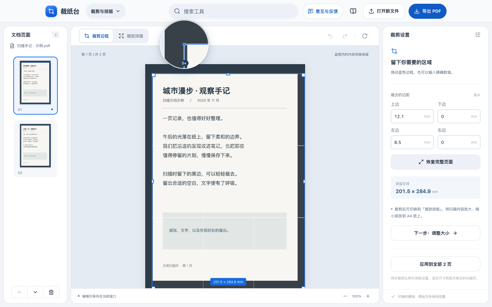
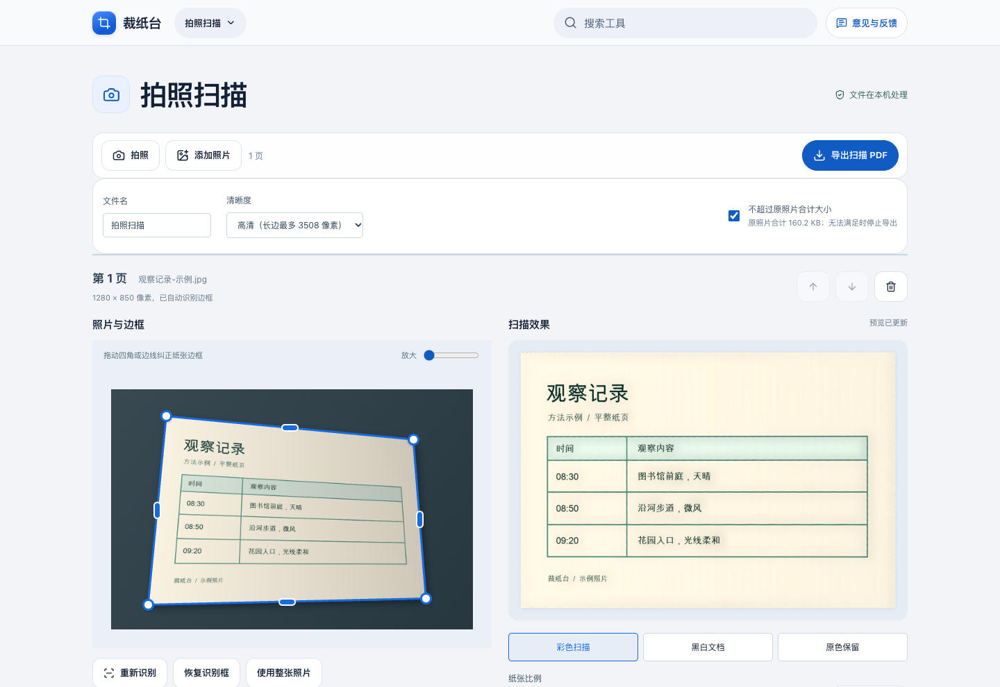

# Caizhitai (裁纸台)

[简体中文](README.md) · [English](README.en.md) · [日本語](README.ja.md) · **한국어**

Caizhitai는 브라우저에서 쓰는 오픈 소스 문서 도구입니다. 스캔 문서의 검은 테두리를 자르고 PDF 페이지를 정리하거나, 종이 사진을 보정해 스캔 PDF로 만들 수 있습니다. PDF, 이미지, 오피스 파일 형식 간 변환도 지원합니다. 파일은 기기의 브라우저에서 처리하며 온라인 도구는 가입 없이 사용할 수 있습니다.

**[온라인에서 사용하기](https://tuditudi.github.io/caizhitai-pdf/)** · [의견 보내기](https://wj.qq.com/s2/28624021/oft7/)

## 빠른 시작

1. 홈 화면에서 도구 이름이나 JPG, EPUB 같은 형식을 검색하거나 카테고리에서 고릅니다. 도구 화면의 상단에서도 검색하고 다른 도구로 이동할 수 있습니다.
2. 기기에서 파일을 선택하거나 끌어다 놓습니다. 자르기를 체험하려면 [자르기 및 레이아웃](https://tuditudi.github.io/caizhitai-pdf/#/tools/crop)을 열고 「先用示例试试看」(샘플로 체험하기)을 누릅니다.
3. 설정과 미리보기를 확인하고 결과를 다운로드합니다. 새로고침하거나 탭을 닫기 전에 저장하세요.

화면은 중국어 간체로 표시됩니다. 이 문서에 함께 표시한 중국어는 실제 화면의 버튼 이름입니다.

## 자르기 및 레이아웃

페이지를 고른 뒤 파란색 테두리의 모서리나 변을 끌거나, 잘라낼 여백을 밀리미터 단위로 입력합니다. 드래그하는 동안 **3배 확대경**에 종이 가장자리와 파란색 자르기 선이 표시되고, 손을 떼면 사라집니다. 「缩放排版」(배율 및 레이아웃)에서 용지 크기, 여백, 내용의 크기를 변경할 수 있습니다. 페이지에서 내용을 끌 때도 확대경이 표시됩니다. 페이지를 회전·정렬·삭제하거나 현재 설정을 모든 페이지에 적용할 수 있습니다. 휴대전화에서는 「查看裁剪设置」(자르기 설정 보기)를 눌러 여백 설정으로 이동합니다.

[휴대전화 자르기 화면 보기](docs/images/crop-mobile.png)

자르기 결과의 크기는 **원본 PDF의 실제 바이트 수**로 제한됩니다. 원본 이미지와 텍스트를 먼저 재사용하며 상한을 넘으면 압축을 시도할 수 있습니다. 압축하면 화질이 떨어지거나 검색 가능한 텍스트가 사라질 수 있습니다. 압축 후에도 상한을 넘으면 다운로드를 중단합니다. 잘라낸 영역의 데이터가 파일에 남을 수 있으므로 민감한 내용은 전용 삭제 도구로 처리하세요.

## 사진 스캔

카메라로 찍거나 JPG, PNG, WebP, HEIC/HEIF 파일을 불러옵니다. 종이의 네 모서리를 감지해 원근을 보정하고 미리보기를 생성합니다. 모서리와 변을 직접 조절하고 컬러, 흑백, 원본 색상 중 하나를 선택할 수 있습니다. 보정 강도, 용지 비율, 회전을 바꾸면 미리보기가 자동으로 갱신됩니다. 여러 사진의 순서를 바꾸고 하나의 스캔 PDF로 내보낼 수 있습니다.

모서리가 둥근 카드의 가장자리도 감지할 수 있습니다. 카드의 작은 글자와 무늬를 확인하려면 컬러 또는 원본 색상을 선택할 수 있습니다. 여러 사진을 가져올 때 진행 상태를 표시하며, 가장자리를 정확히 감지하기 어려우면 확인을 요청합니다. 결과는 이미지로 구성된 PDF입니다. 기본 크기 제한은 원본 사진의 합계이며 스캔 도구에서 해제할 수 있습니다.

## 문서 변환

- **PDF를 Word로 변환.** 인식한 페이지를 연속으로 스크롤하고 텍스트를 눌러 원래 위치에서 편집합니다. DOCX에서도 텍스트 상자를 편집할 수 있으며 표의 선, 사진, 도장 이미지는 페이지 배경에 보존됩니다. PDF에 글꼴의 일부만 포함되어 있다면 편집용 임베딩이 허용된 동일한 전체 원본 글꼴(TTF, OTF 또는 TTC)이 필요합니다. 스캔 문서는 OCR로 인식하고 글꼴을 직접 지정합니다. 글꼴에 없는 문자가 있거나 텍스트가 상자를 벗어나면 글꼴을 추가하거나 상자 크기를 조절하라는 안내를 표시합니다. [Word 편집 화면 보기](docs/images/pdf-to-word.png)
- **PDF를 EPUB으로 변환.** 자동 모드에서 텍스트 레이어를 사용할 수 있는 페이지는 읽기 화면에 맞춰 글을 다시 배치합니다. 스캔이나 만화는 페이지 이미지 모드로 원래 배치를 유지할 수 있습니다. 기본 표지는 선택한 첫 페이지입니다. 전자책 언어는 EPUB 메타데이터에 기록합니다. 중국어 간체·번체, 영어, 일본어, 한국어 등을 선택할 수 있습니다. OCR 언어는 별도로 설정하며 중국어 간체와 영어를 함께 사용하거나 영어만 선택할 수 있습니다. [EPUB 변환 화면 보기](docs/images/pdf-to-epub.png)
- **OFD를 PDF로 변환.** 첫 페이지를 미리 보고 전체 또는 선택한 페이지를 원래 크기로 내보냅니다. 가능한 경우 글자 윤곽과 선을 벡터로 유지하고 복잡한 페이지에는 고해상도 무손실 이미지를 사용합니다. 내장 글꼴이 없으면 대체 글꼴이 적용됩니다. 전자 서명은 원본 OFD에서 확인하세요. [OFD 변환 화면 보기](docs/images/ofd-to-pdf.png)

## 전체 도구 13개

| 도구 | 할 수 있는 작업 |
| --- | --- |
| [자르기 및 레이아웃](https://tuditudi.github.io/caizhitai-pdf/#/tools/crop) | 테두리를 자르고 용지나 내용의 크기를 조절하며 페이지 순서를 바꿉니다. |
| [PDF 합치기](https://tuditudi.github.io/caizhitai-pdf/#/tools/merge) | 여러 PDF의 순서를 정해 하나의 파일로 합칩니다. |
| [PDF 나누기](https://tuditudi.github.io/caizhitai-pdf/#/tools/split) | 한 페이지씩, 일정한 페이지 수씩 또는 지정한 범위로 나눕니다. <code>1-3,5;6-8</code>을 입력하면 PDF 두 개를 만들고 ZIP으로 묶습니다. |
| [PDF를 Word로 변환](https://tuditudi.github.io/caizhitai-pdf/#/tools/word) | 텍스트를 제자리에서 수정하고 레이아웃을 유지한 DOCX로 내보냅니다. |
| [PDF를 EPUB으로 변환](https://tuditudi.github.io/caizhitai-pdf/#/tools/epub) | 다시 배치되는 텍스트나 페이지 이미지로 목차와 선택 가능한 표지가 있는 EPUB 3를 만듭니다. |
| [PDF를 이미지로 변환](https://tuditudi.github.io/caizhitai-pdf/#/tools/pdf-to-images) | 페이지와 해상도를 선택해 PNG 또는 JPG로 내보냅니다. 여러 장은 ZIP으로 받을 수 있습니다. |
| [PDF를 PowerPoint로 변환](https://tuditudi.github.io/caizhitai-pdf/#/tools/pdf-to-ppt) | 선택한 페이지를 이미지 슬라이드로 만들어 PPTX로 내보냅니다. |
| [PDF를 Excel로 변환](https://tuditudi.github.io/caizhitai-pdf/#/tools/pdf-to-excel) | 추출하거나 인식한 표를 검토한 뒤 XLSX로 내보냅니다. 페이지를 이미지로 넣을 수도 있습니다. |
| [OFD를 PDF로 변환](https://tuditudi.github.io/caizhitai-pdf/#/tools/ofd-to-pdf) | 첫 페이지를 미리 보고 선택한 페이지를 원래 크기로 내보냅니다. |
| [사진 스캔](https://tuditudi.github.io/caizhitai-pdf/#/tools/photo-scan) | 종이 사진의 원근과 색상을 보정하고 미리 본 뒤 스캔 PDF로 저장합니다. |
| [이미지를 PDF로 변환](https://tuditudi.github.io/caizhitai-pdf/#/tools/images-to-pdf) | PNG, JPG/JPEG, WebP, BMP, GIF 파일을 정렬하고 합칩니다. GIF는 첫 프레임을 사용합니다. |
| [PowerPoint를 PDF로 변환](https://tuditudi.github.io/caizhitai-pdf/#/tools/ppt-to-pdf) | PPT나 PPTX를 미리 보고 선택한 슬라이드를 정적인 PDF 페이지로 내보냅니다. |
| [Excel을 PDF로 변환](https://tuditudi.github.io/caizhitai-pdf/#/tools/excel-to-pdf) | XLS, XLSX, XLSM에서 시트와 용지 방향을 선택하고 행에 맞춰 페이지를 나눕니다. |

## 파일 및 피드백

- 파일 가져오기, 미리보기, 내보내기는 브라우저에서 실행됩니다. OCR 모델과 글꼴 같은 공용 리소스는 사이트에서 불러옵니다.
- 파일당 PDF는 200 MB, OFD는 80 MB까지 지원합니다. 실제 처리 능력은 기기의 메모리와 문서의 복잡도에도 영향을 받습니다.
- OCR 결과, 복잡한 표, 변환 후 레이아웃은 다운로드 전에 확인하세요. Excel을 PDF로 변환할 때는 통합 문서에 저장된 수식의 계산 결과를 사용합니다.
- 홈이나 도구 화면에서 「意见与反馈」(피드백)를 누르면 Tencent 설문이 열립니다. 오류를 신고할 때는 도구 이름, 작업 순서, 표시된 오류 메시지를 적어 주세요.

## 로컬에서 실행하기

Node.js 22.13 이상, npm, Python 3가 필요합니다. 프로젝트 디렉터리에서 다음 명령을 실행합니다.

~~~bash
npm ci
npm run build:web
python3 -m http.server 5176 --bind 127.0.0.1 --directory offline-dist
~~~

[브라우저에서 로컬 버전 열기](http://127.0.0.1:5176/)

## 라이선스

프로젝트 코드는 [MIT 라이선스](LICENSE)로 공개합니다. 함께 제공하는 리소스에는 각각의 라이선스가 적용됩니다. [PDF](public/pdf-assets/LICENSE) · [OCR](public/ocr/NOTICE.md) · [스캔](public/scanner/NOTICE.md) · [Office](public/office-assets/licenses.html) · [OFD](public/ofd-assets/)
