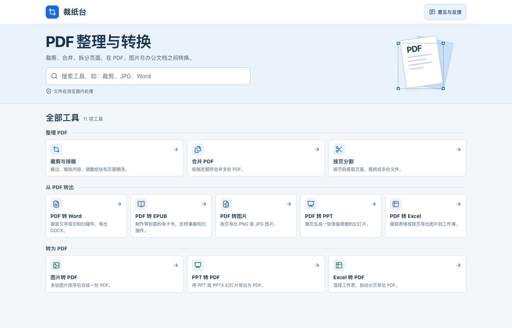
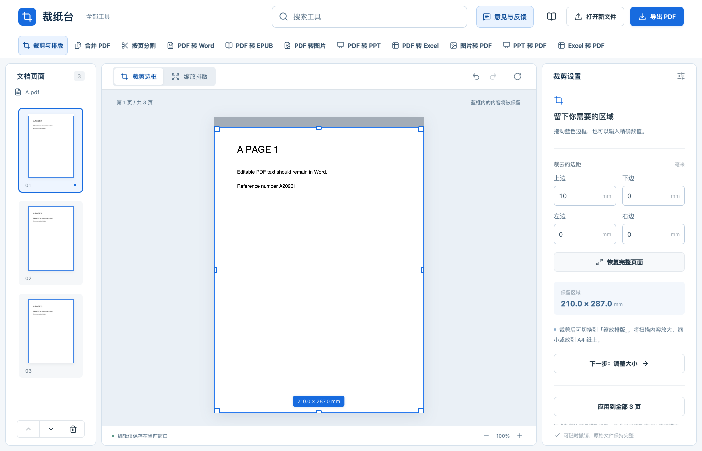

# Caizhitai (裁纸台)

[简体中文](README.md) · [English](README.en.md) · [日本語](README.ja.md) · **한국어**

**[온라인에서 Caizhitai 사용하기](https://tuditudi.github.io/caizhitai-pdf/)** · [의견 보내기](https://wj.qq.com/s2/28624021/oft7/)

Caizhitai는 브라우저에서 사용하는 PDF 도구 모음입니다. 스캔 문서의 검은 테두리를 자르고 A4 용지에 맞추거나, 여러 PDF를 합치고 나눌 수 있습니다. PDF, 이미지, 일반적인 오피스 파일 형식 간 변환도 지원합니다. 불러온 파일과 변환 결과는 사용 중인 브라우저에서 처리합니다.



## 빠른 시작

1. 홈 화면에서 도구 이름이나 JPG, Word, EPUB 같은 파일 형식을 검색하거나 카테고리에서 도구를 선택합니다. 도구 화면 상단의 검색창에서도 다른 도구로 이동할 수 있습니다.
2. 기기에서 파일을 선택합니다. 자르기 기능을 체험하려면 「裁剪与排版」(자르기 및 레이아웃)을 열고 「先用示例试试看」(샘플로 체험하기)을 누릅니다.
3. 설정을 조정하고 미리보기를 확인한 뒤 결과를 다운로드합니다. 새로고침하거나 탭을 닫기 전에 결과를 저장하세요.

현재 화면은 중국어 간체로 표시됩니다. 겹낫표 안에 있는 중국어는 실제 화면의 버튼 이름입니다.

## 11개 도구

| 도구 | 사용 방법과 결과 |
| --- | --- |
| PDF 자르기 및 레이아웃 | 파란색 테두리를 끌거나 여백을 밀리미터 단위로 입력합니다. 용지 크기, 여백, 배율을 조정하고 페이지를 회전하거나 순서를 바꾸거나 삭제할 수 있습니다. |
| PDF 합치기 | 여러 PDF를 추가하고 순서를 정한 뒤 하나의 파일로 저장합니다. |
| PDF 나누기 | 한 페이지씩, 일정한 페이지 수씩, 또는 지정한 범위로 나눕니다. `1-3,5;6-8`을 입력하면 PDF 두 개가 생성되며, 결과를 ZIP으로 다운로드할 수 있습니다. |
| PDF를 Word로 변환 | 텍스트를 추출하거나 중국어 간체 및 영어 스캔 문서를 OCR로 인식합니다. 내용을 검토한 뒤 DOCX로 내보내거나 원본 페이지를 이미지로 유지할 수 있습니다. |
| PDF를 EPUB으로 변환 | 텍스트를 화면 크기에 맞게 다시 배치하거나 만화와 스캔 페이지를 이미지로 유지합니다. 기본값은 선택한 첫 페이지를 표지로 사용합니다. 전자책 언어는 EPUB에 언어 정보를 기록하며, OCR 인식 언어는 별도로 설정합니다. |
| PDF를 이미지로 변환 | 페이지와 해상도를 선택해 PNG 또는 JPG로 내보냅니다. 여러 이미지가 생성되면 ZIP으로 다운로드할 수 있습니다. |
| PDF를 PowerPoint로 변환 | PDF 페이지마다 이미지 슬라이드 한 장을 만들고 PPTX로 내보냅니다. |
| PDF를 Excel로 변환 | 표를 추출하거나 스캔 페이지를 인식합니다. 결과를 검토·수정한 뒤 XLSX로 내보내거나 각 페이지를 이미지로 넣을 수 있습니다. |
| 이미지를 PDF로 변환 | PNG, JPG/JPEG, WebP, BMP, GIF의 순서를 정해 한 개의 PDF로 합칩니다. GIF는 첫 프레임을 사용합니다. |
| PowerPoint를 PDF로 변환 | PPT와 PPTX를 지원합니다. 슬라이드를 미리 보고 내보낼 페이지를 선택할 수 있습니다. |
| Excel을 PDF로 변환 | XLS, XLSX, XLSM을 지원합니다. 시트와 용지 방향을 선택하고 페이지 단위로 내보냅니다. |

## 자르기 및 레이아웃

데스크톱에서는 왼쪽 썸네일에서 페이지를 선택합니다. 파란색 테두리를 끌어 남길 영역을 정하거나 오른쪽 설정에 여백을 입력합니다. 스마트폰에서는 「查看裁剪设置」(자르기 설정 보기)를 눌러 여백 설정으로 이동할 수 있습니다. 용지 크기나 여백을 조정하려면 「缩放排版」(배율 및 레이아웃)으로 전환합니다.



[스마트폰 자르기 화면 보기](docs/images/crop-mobile.png)

자르기 결과의 용량 상한은 **원본 PDF의 실제 바이트 수**입니다. 원본 이미지와 텍스트를 우선 재사용하고 상한을 넘으면 압축을 시도할 수 있습니다. 압축 후에도 상한을 넘으면 다운로드를 중단합니다. 압축으로 이미지 품질이 낮아지거나 검색 가능한 텍스트 레이어가 사라질 수 있습니다. 잘라낸 영역의 데이터가 파일에 남을 수 있으므로 민감한 정보는 전용 삭제 도구로 처리하세요.

## 로컬에서 실행하기

Node.js 22.13 이상, npm, Python 3가 필요합니다. 프로젝트 디렉터리에서 다음 명령을 실행합니다.

```bash
npm ci
npm run build:web
python3 -m http.server 5176 --bind 127.0.0.1 --directory offline-dist
```

실행한 뒤 [로컬 Caizhitai](http://127.0.0.1:5176/)를 엽니다.

## 파일 및 피드백

- PDF, 이미지, 문서 변환은 브라우저에서 실행됩니다. OCR 모델이나 글꼴 같은 공용 리소스는 웹사이트에서 불러옵니다.
- PDF 한 개의 용량 상한은 200MB입니다. 실제 처리 가능한 용량은 기기의 메모리와 페이지의 복잡도에 따라 달라집니다.
- Word 및 Excel의 인식 결과는 미리보기에서 검토하고 수정할 수 있습니다. 복잡한 레이아웃은 단순화될 수 있습니다. Excel을 PDF로 변환할 때는 통합 문서에 저장된 수식의 계산 결과를 사용합니다.
- 홈 또는 도구 화면에서 「意见与反馈」(피드백)를 누르면 Tencent 설문이 열립니다. 오류를 신고할 때는 도구 이름, 재현 절차, 표시된 오류 메시지를 적어 주세요.

## 라이선스

Caizhitai 프로젝트 코드는 [MIT 라이선스](LICENSE)로 공개됩니다. 함께 제공하는 PDF.js, Tesseract.js, OCR 모델, 글꼴에는 각각의 원본 라이선스가 적용됩니다. [PDF 리소스](public/pdf-assets/), [OCR 리소스](public/ocr/NOTICE.md), [Office 리소스](public/office-assets/licenses.html)의 안내를 참고하세요.
