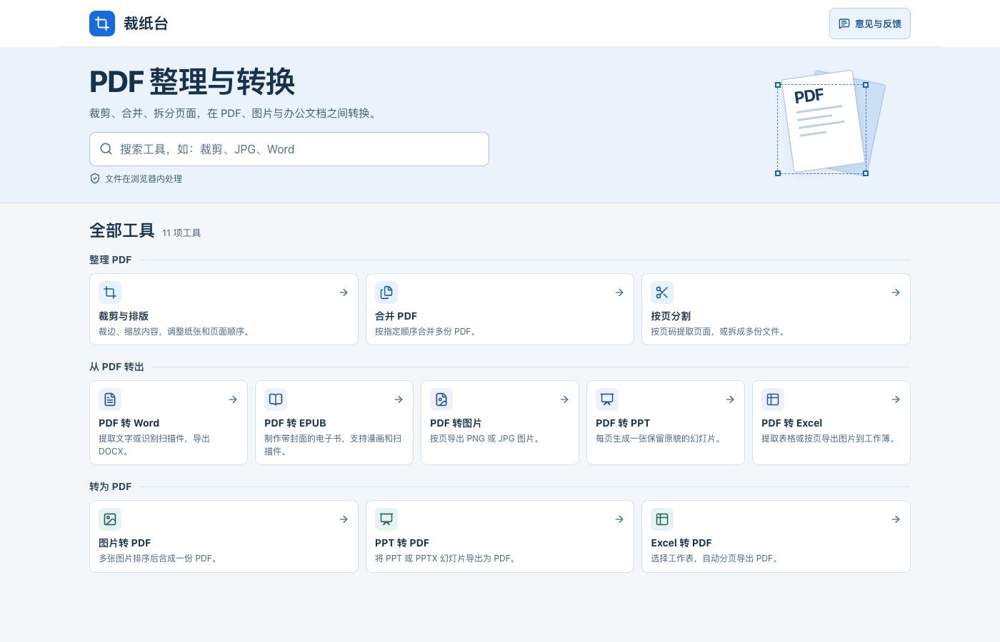
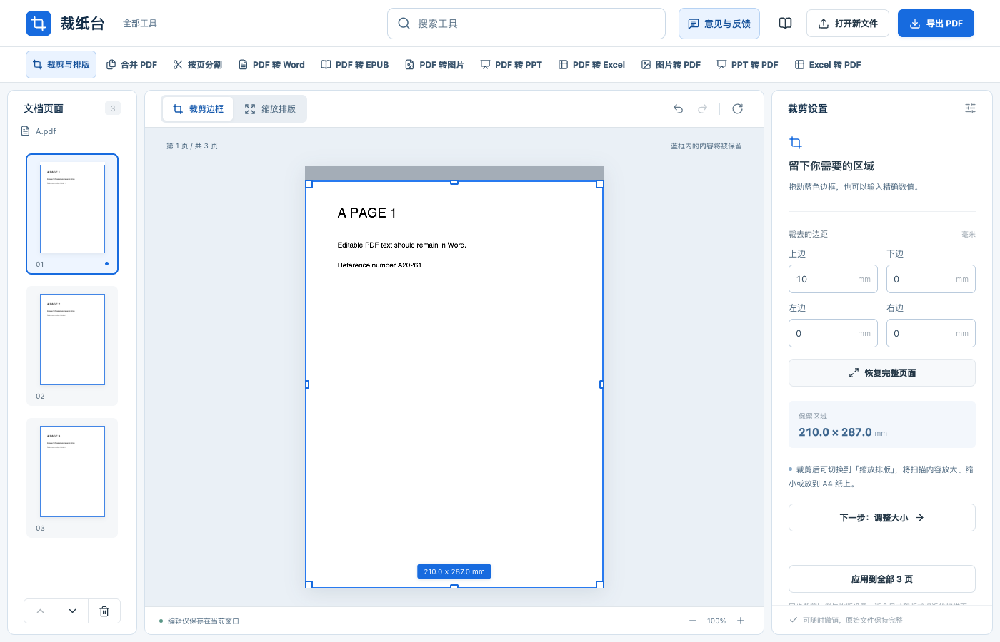

# 裁纸台

**简体中文** · [English](README.en.md) · [日本語](README.ja.md) · [한국어](README.ko.md)

**[打开裁纸台在线试用](https://tuditudi.github.io/caizhitai-pdf/)** · [意见与反馈](https://wj.qq.com/s2/28624021/oft7/)

裁纸台是一套在浏览器里运行的 PDF 工具。可以裁掉扫描件的黑边、把内容排到 A4 纸上，也可以合并、分割文档，在 PDF、图片和常见办公格式之间转换。导入的文件和转换结果由当前浏览器处理。



## 快速开始

1. 在首页搜索「裁剪」「JPG」「Word」等关键词，或从分类列表中选工具。工具页顶部也可以搜索和切换。
2. 选择本机文件。想先体验裁剪，可以点「先用示例试试看」。
3. 调整设置，核对预览，再导出并下载。刷新或关闭标签页前请先保存结果。

## 11 项工具

| 工具 | 用法和结果 |
| --- | --- |
| 裁剪与排版 | 拖动蓝框或输入毫米边距，调整纸张、留白和缩放。也可旋转、排序、删除页面。 |
| 合并 PDF | 导入多份 PDF，调整顺序后合为一份。 |
| 按页分割 | 按单页、固定页数或指定范围拆分。`1-3,5;6-8` 会生成两份 PDF，多份结果打包为 ZIP。 |
| PDF 转 Word | 提取文字或识别中英文扫描页，校对后导出 DOCX。也可将原页面作为图片保留。 |
| PDF 转 EPUB | 文字可重排，漫画和扫描页可保留原图。默认使用首个选中页作为封面。电子书语言用于标记 EPUB 的主要语言，扫描识别使用单独的语言设置。 |
| PDF 转图片 | 选择页码和清晰度，导出 PNG 或 JPG。多页结果可下载为 ZIP。 |
| PDF 转 PPT | 每页 PDF 生成一张图片幻灯片，导出 PPTX。 |
| PDF 转 Excel | 提取表格或识别扫描页，校对后导出 XLSX。也可按页插入图片。 |
| 图片转 PDF | PNG、JPG/JPEG、WebP、BMP 和 GIF 可排序后合成 PDF。GIF 使用首帧。 |
| PPT 转 PDF | 支持 PPT 和 PPTX，可预览幻灯片并选择导出页。 |
| Excel 转 PDF | 支持 XLS、XLSX 和 XLSM，可选择工作表和纸张方向，再分页导出。 |

## 裁剪与排版

在桌面上从左侧选择页面，拖动蓝框留下需要的区域，也可以在右侧填写边距。手机上点「查看裁剪设置」即可跳到边距面板。需要调整纸张或留白时，切换到「缩放排版」。



[查看手机裁剪界面](docs/images/crop-mobile.png)

裁剪导出的上限等于**原 PDF 的实际字节数**。程序优先复用原图和文字，超限时可尝试压缩。仍超限就停止下载。压缩可能降低清晰度或移除可搜索文字层。可视化裁剪可能保留框外数据，处理敏感信息时请使用专门的脱敏工具。

## 本地运行

需要 Node.js 22.13 或更新版本、npm 和 Python 3。在项目目录运行以下命令。

```bash
npm ci
npm run build:web
python3 -m http.server 5176 --bind 127.0.0.1 --directory offline-dist
```

然后打开 [本地裁纸台](http://127.0.0.1:5176/)。

## 文件与反馈

- PDF、图片和文档转换在浏览器内执行。识别模型与字体等公共资源由网站提供。
- 单份 PDF 支持最大 200 MB。实际处理能力也受设备内存和页面复杂度影响。
- Word 和 Excel 的识别结果可在预览中校对。复杂排版可能简化，Excel 转 PDF 使用工作簿内保存的公式结果。
- 在首页或任意工具页点「意见与反馈」可打开腾讯问卷。报告问题时，可填写工具名称、操作步骤和报错文字。

## 开源许可

裁纸台项目代码采用 [MIT 许可证](LICENSE)。随附的 PDF.js、Tesseract.js、OCR 模型、字体等第三方资源适用各自的上游许可。声明见 [PDF 资源](public/pdf-assets/)、[OCR 资源](public/ocr/NOTICE.md) 和 [Office 资源](public/office-assets/licenses.html)。
