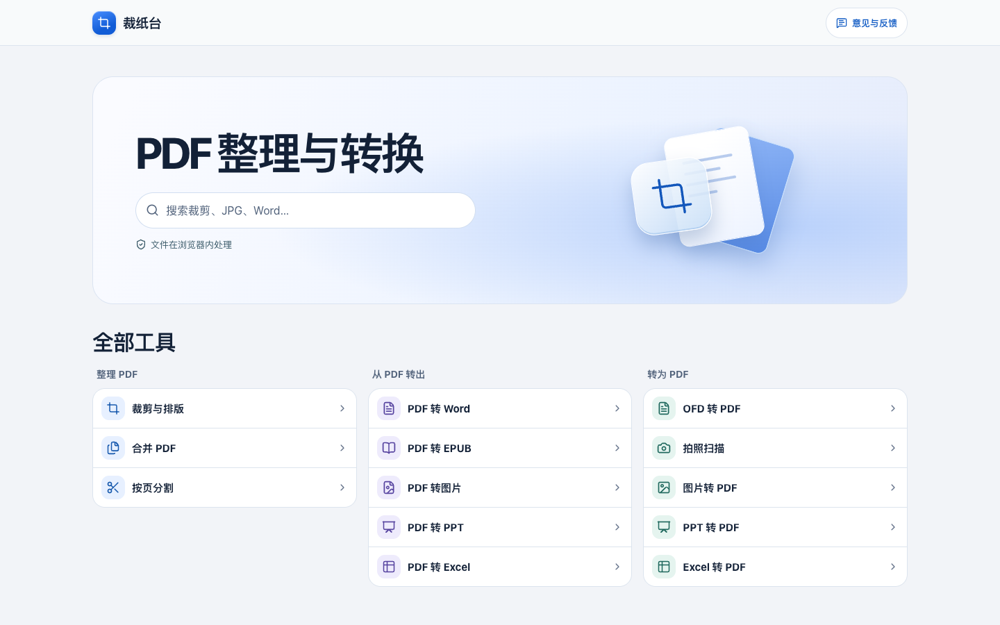
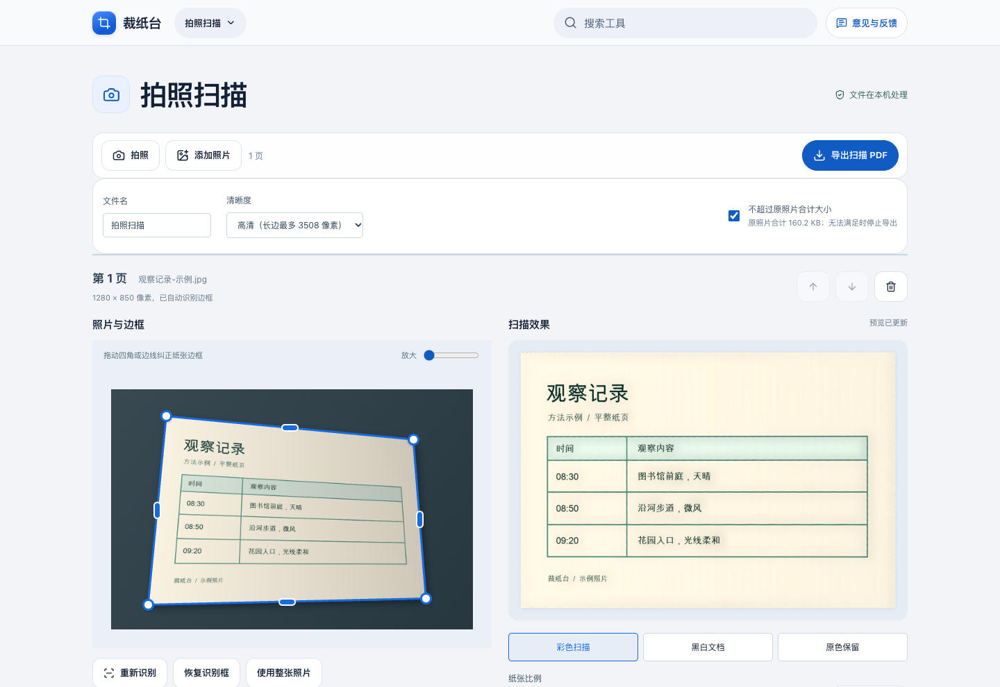

# 裁纸台

**简体中文** · [English](README.en.md) · [日本語](README.ja.md) · [한국어](README.ko.md)

裁纸台是一套开源的浏览器文档工具。你可以裁掉扫描件的黑边、整理 PDF 页面、把手机照片拉正成扫描件，还能在 PDF、图片和常见办公格式之间转换。文件由浏览器在本机处理，在线试用无需注册。

**[打开裁纸台在线试用](https://tuditudi.github.io/caizhitai-pdf/)** · [意见与反馈](https://wj.qq.com/s2/28624021/oft7/)

## 快速开始

1. 在首页搜索工具名或格式，例如「裁剪」「JPG」或「EPUB」。工具页顶部也可以搜索和切换。
2. 选择或拖入本机文件。想先体验裁剪，打开[裁剪与排版](https://tuditudi.github.io/caizhitai-pdf/#/tools/crop)并点击「先用示例试试看」。
3. 调整设置、核对预览，再下载结果。刷新或关闭标签页前请先保存。

## 裁剪与排版

选中页面后，拖动蓝框的四角或边线，或输入要裁去的毫米数。拖动时 **3 倍放大镜**会显示纸张边缘和蓝色裁剪线，松手后自动收起。切换到「缩放排版」可更改纸张尺寸、留白和内容大小，在纸面上拖动内容也会显示放大镜。还可旋转、排序、删除页面，把当前设置应用到全部页。手机上点「查看裁剪设置」可跳到边距面板。

[查看手机裁剪界面](docs/images/crop-mobile.png)

裁剪导出以**原 PDF 的实际字节数**为上限。优先复用原图和文字，超限时可尝试压缩。压缩可能降低清晰度或移除可搜索文字层，仍超限则停止下载。可视化裁剪可能保留框外数据，敏感内容请用专门的脱敏工具删除。

## 拍照扫描

拍照或导入 JPG、PNG、WebP、HEIC／HEIF。裁纸台会尝试识别纸张四角，校正透视并自动生成预览。可拖动角点和边线，切换彩色、黑白或原色保留，调整增强程度、纸张比例和方向。预览会随设置更新，多张照片可排序后合成一份扫描 PDF。

也支持识别圆角证件的边框。处理证件时可选彩色或原色保留，方便核对细小文字和底纹。导入多张照片时会显示处理进度，边框识别把握较低时会提示核对。扫描结果是图片型 PDF，默认以原照片的合计大小为导出上限，可在拍照扫描工具内关闭此限制。

## 文档转换

- **PDF 转 Word**。识别后连续滚动预览，点击文字即可在原位置编辑。DOCX 中的文字仍可编辑，表格线、照片和印章保留在页面背景中。PDF 只有字体子集时，需补齐允许编辑嵌入的完整原字体（TTF、OTF 或 TTC）。扫描页用 OCR 识别文字，需手动指定字体。遇到缺字或文字框放不下时，界面会提示补齐字体或调整文字框。 [查看 Word 编辑界面](docs/images/pdf-to-word.png)
- **PDF 转 EPUB**。自动模式将有可用文字层的页面转为可重排文字，扫描页和漫画页可选「页面图片」保留原貌。默认用所选第一页做封面。电子书语言支持简体中文、繁体中文、英语、日语、韩语等，用于标记 EPUB 的主要语言。OCR 单独设置，目前可选简体中文加英文或仅英文。 [查看 EPUB 转换界面](docs/images/pdf-to-epub.png)
- **OFD 转 PDF**。可预览首页并按原尺寸导出全部或指定页面。文字轮廓和线条优先保留为矢量，复杂页面使用高清无损图像，缺少内嵌字体时使用替代字体。请在原 OFD 中验证电子签名。 [查看 OFD 转换界面](docs/images/ofd-to-pdf.png)

## 全部 13 项工具

| 工具 | 可完成的操作 |
| --- | --- |
| [裁剪与排版](https://tuditudi.github.io/caizhitai-pdf/#/tools/crop) | 裁边、缩放、调整纸张和页面顺序。 |
| [合并 PDF](https://tuditudi.github.io/caizhitai-pdf/#/tools/merge) | 将多份 PDF 按调整后的顺序合成一份。 |
| [按页分割](https://tuditudi.github.io/caizhitai-pdf/#/tools/split) | 按单页、固定页数或范围拆分。<code>1-3,5;6-8</code> 生成两份 PDF，多份结果打包为 ZIP。 |
| [PDF 转 Word](https://tuditudi.github.io/caizhitai-pdf/#/tools/word) | 编辑原位文字，保留页面版式，导出 DOCX。 |
| [PDF 转 EPUB](https://tuditudi.github.io/caizhitai-pdf/#/tools/epub) | 生成带目录和可选封面的 EPUB 3，支持文字重排和页面图片。 |
| [PDF 转图片](https://tuditudi.github.io/caizhitai-pdf/#/tools/pdf-to-images) | 按页码和清晰度导出整页 PNG 或 JPG，多页可打包为 ZIP。 |
| [PDF 转 PPT](https://tuditudi.github.io/caizhitai-pdf/#/tools/pdf-to-ppt) | 将选中的 PDF 页面逐页转换为图片幻灯片，导出 PPTX。 |
| [PDF 转 Excel](https://tuditudi.github.io/caizhitai-pdf/#/tools/pdf-to-excel) | 提取或识别表格，校对后导出 XLSX，也可将整页作为图片插入。 |
| [OFD 转 PDF](https://tuditudi.github.io/caizhitai-pdf/#/tools/ofd-to-pdf) | 预览首页，选择页码并按原尺寸导出。 |
| [拍照扫描](https://tuditudi.github.io/caizhitai-pdf/#/tools/photo-scan) | 修正纸张透视，预览增强效果，合成扫描 PDF。 |
| [图片转 PDF](https://tuditudi.github.io/caizhitai-pdf/#/tools/images-to-pdf) | 将 PNG、JPG／JPEG、WebP、BMP 或 GIF 排序并合成 PDF。GIF 使用首帧。 |
| [PPT 转 PDF](https://tuditudi.github.io/caizhitai-pdf/#/tools/ppt-to-pdf) | 预览 PPT 或 PPTX，选择幻灯片并导出静态 PDF 页面。 |
| [Excel 转 PDF](https://tuditudi.github.io/caizhitai-pdf/#/tools/excel-to-pdf) | 从 XLS、XLSX 或 XLSM 中选择工作表和纸张方向，按行分页。 |

## 文件与反馈

- 导入、预览和导出在浏览器内完成。网站会提供 OCR 模型、字体等公共资源。
- 单份 PDF 最多 200 MB，OFD 最多 80 MB。实际处理能力也取决于设备内存和页面复杂度。
- OCR、复杂表格和版式转换请在下载前核对结果。Excel 转 PDF 使用工作簿内保存的公式计算结果。
- 首页和工具页的「意见与反馈」会打开腾讯问卷。反馈问题时请提供工具名称、操作步骤和报错文字。

## 本地运行

需要 Node.js 22.13 或更新版本、npm 和 Python 3。在项目目录执行下列命令。

~~~bash
npm ci
npm run build:web
python3 -m http.server 5176 --bind 127.0.0.1 --directory offline-dist
~~~

[在本机浏览器中打开裁纸台](http://127.0.0.1:5176/)

## 开源许可

项目代码采用 [MIT 许可证](LICENSE)。随附资源遵循各自的上游许可。 [PDF](public/pdf-assets/LICENSE) · [OCR](public/ocr/NOTICE.md) · [扫描](public/scanner/NOTICE.md) · [Office](public/office-assets/licenses.html) · [OFD](public/ofd-assets/)
